<div align="center">


<br/>

**Electrical engineering student at Purdue who ships across the whole stack:**
**FPGA and firmware at the bottom, AI agent workflows at the top.**

[](https://www.linkedin.com/in/jensenwang1122)
[](mailto:jensenwang1122@gmail.com)

</div>

<br/>

## Why the whole stack matters

Most hardware teams treat software as an afterthought, and most software teams treat hardware as a black box. I work on both sides of that line, so I can find the bug that lives on the seam.

| Layer | What I do there |
|---|---|
| **Silicon** | MTJ thermal reliability analysis, FPGA-based stress-test development, and RTL verification for MRAM controllers at Purdue's SoCET lab. |
| **Firmware** | Bare-metal C on ARM Cortex-M. SPI, I2C, ADC, PWM, timer interrupts. I wrote a TFT display driver from scratch, including the font renderer. |
| **Software** | Python and SQL for data products and inspection pipelines. Computer vision for industrial defect detection. |
| **Agents** | Multi-step AI workflows with a spec, a verification step, and a decision log, so the output can be trusted and reproduced. |

<br/>

## Track record



<br/>

- **Semiconductor research.** Part of the Purdue MRAM team studying memory reliability under high temperature stress.
- **Startup camp.** Co-founded a medical data platform at European Innovation Academy in Porto. Led UI/UX, shipped 15+ wireframes and mockups, and pitched to VCs and angels.
- **Industry work.** Consulting project for a Taiwanese electronics manufacturer on GaN and SiC power semiconductors. Mapped Taiwan's GaN supply chain against global IDMs. Published in DIGITIMES.

<br/>

## Looking for

- **Startups at the hardware and software boundary:** embedded, FPGA, edge AI, AI infrastructure, robotics, devices.
- **Roles where one person owns a problem end to end,** from the sensor to the dashboard to the agent that watches it.
- Early-stage teams that move fast and want someone who learns the missing layer instead of waiting for it.

If you are building something in that space, [send me a note](mailto:jensenwang1122@gmail.com).

<br/>

## Toolbox

```text
Languages   C, C++, Python, SystemVerilog, Verilog, SQL, RISC-V assembly, MATLAB
Hardware    ARM Cortex-M (RP2350), Terasic FPGA (Cyclone IV/V), Intel Quartus
Interfaces  SPI, I2C, UART, ADC, PWM, AHB/APB, JTAG
Software    Git, FastAPI, YOLO, Figma, Ansys thermal simulation
Agents      Claude Code, spec-driven workflows, verification-first pipelines
```

<br/>

<div align="center"><sub>Originally from Taiwan. Now at Purdue, West Lafayette, Indiana.</sub></div>
