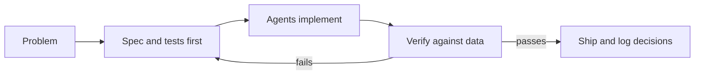

**AI agents, data products, and the hardware underneath them.**
EE at Purdue. I design the workflow, let agents do the typing, and ship.

---

## What I work on

| | Focus | What it means |
|---|---|---|
| 🤖 | **AI agents** | Multi-step agent workflows that research, build, and verify their own output. |
| 📊 | **Data products** | Turning messy data into tools people can actually use and trust. |
| 🔬 | **Hardware** | EE background: embedded systems, FPGA, and memory reliability. |

Most of my repos are private while they are being built. I open them up once they are worth reading.

## How I build

- **Spec first.** Every project has a written model, a decision log, and a verification checklist before the code grows.
- **Agents as teammates.** Claude Code does the implementation. I own the architecture, the validation, and the call on what ships.
- **Evidence over vibes.** A result only counts if I can reproduce it from the data.

## Toolbox

## Activity

<!-- Uncomment after the metrics workflow has run once (see .github/workflows/metrics.yml)

-->

---

Originally from Taiwan, now in West Lafayette. Currently looking for internships in AI, consulting, and hardware.

